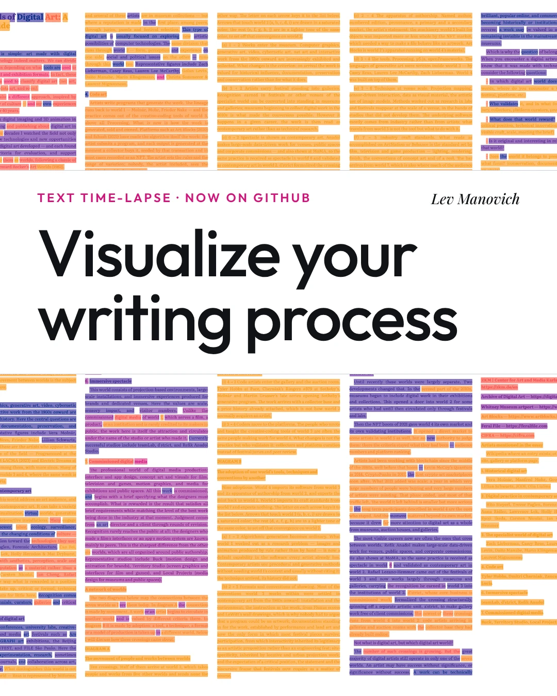
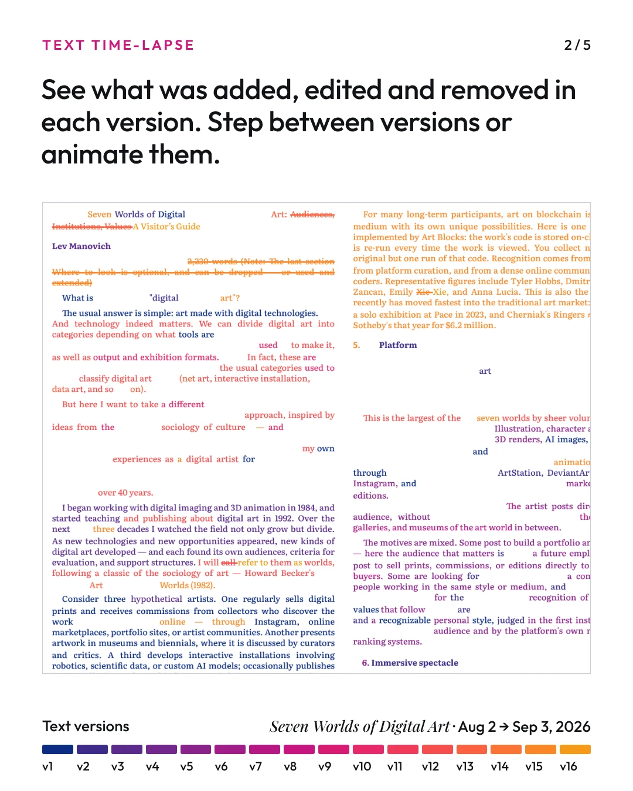
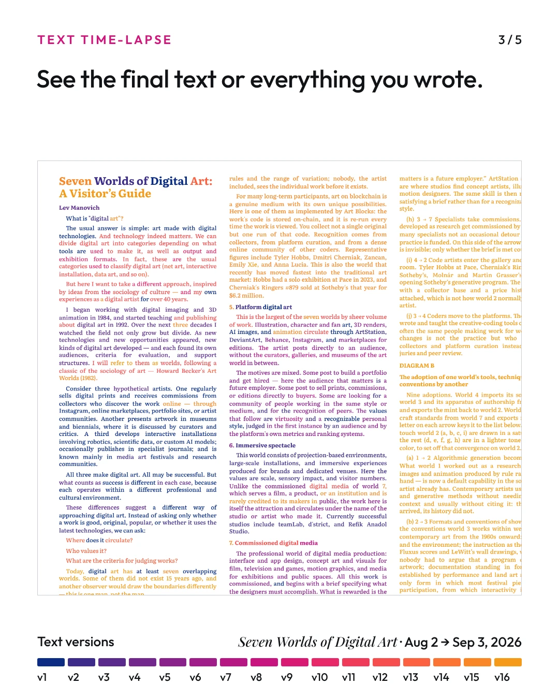

# manovich-interactive

**Interactive tools and visual essays by Lev Manovich**

A collection of **browser-based tools** for exploring cultural data, and selected essays presented as interactive HTML documents. All tools run directly in the browser — no installation required.

---

## Projects

### 1. [ImagePlot 2](imageplot/)

A browser-based tool for the **visualization and analysis of image collections**. Load any set of images, extract **80 visual features** automatically, and explore the collection as an interactive scatter plot — with images rendered directly as data points. Supports PCA, t-SNE, and UMAP projections, compare mode for two collections side by side, and animation along any feature axis.

Originally developed as part of cultural analytics research at the Software Studies Initiative (2009–2011), ImagePlot 2 is a fully redesigned browser-based version.

---

### 2. [How Photography Was Reinvented 43 Times](photo/)

An interactive timeline tracing the **history of automation in photography** — from the invention of this medium in 1820s to AI-driven tools for editing and generation developed in 2020s. Each entry marks a moment when photography was **technically or conceptually transformed**.

---

### 3. [MoMA Artist Networks](moma-networks/)

A browser-based interactive tool for exploring **patterns in MoMA exhibitions between 1929 and 1990** using 500 most exhibited artists during this period. Explore the networks between artists based on co-occurence in exhibitions, and filer by decade, geographic region, gender, and more. 

---

### 4. [Text Time-lapse](text-time-lapse/)

A browser-based tool that shows **how a text changed across its saved versions**. Load versions of your text you were saving while working (.txt, .md or .docx), and the tool creates a visualization of your writing process. You can step through versions and see which text parts were added, edited and removed in each. See the result on one page, as one small page per version, or as a 3D stack of pages, and animate it to watch the text being written and revised. Files are read on your own computer and never uploaded. See the [guide](text-time-lapse/README.md).

  
  
  

---

## About

Lev Manovich is Presidential Professor at The Graduate Center, City University of New York, and a leading theorist in **computational media theory**, **software studies**, **cultural analytics**, and **AI media studies**. His books include *The Language of New Media* (MIT Press, 2001), *Software Takes Command* (Bloomsbury, 2013), and *Cultural Analytics* (MIT Press, 2020).

Since **1994**, Lev Manovich has published all his work online, experimented with new ways to present his ideas and research using new media technologies, and explored their artistic possibilities through projects such as *Little Movies* (1994–1997), *Soft Cinema* (2002–2005), and ImagePlot visualizations of large cultural datasets (2009–). This repository is the latest step in that ongoing practice, now taking the form of **browser-based interactive tools and visual essays** built with AI coding assistants.

→ [manovich.net](http://manovich.net) · [manovich.art](http://manovich.art) · [Cultural Analytics Lab](http://lab.culturalanalytics.info)
