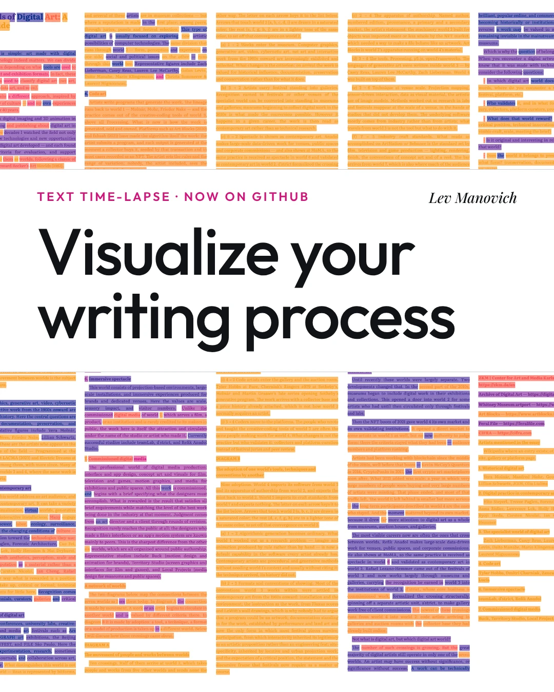
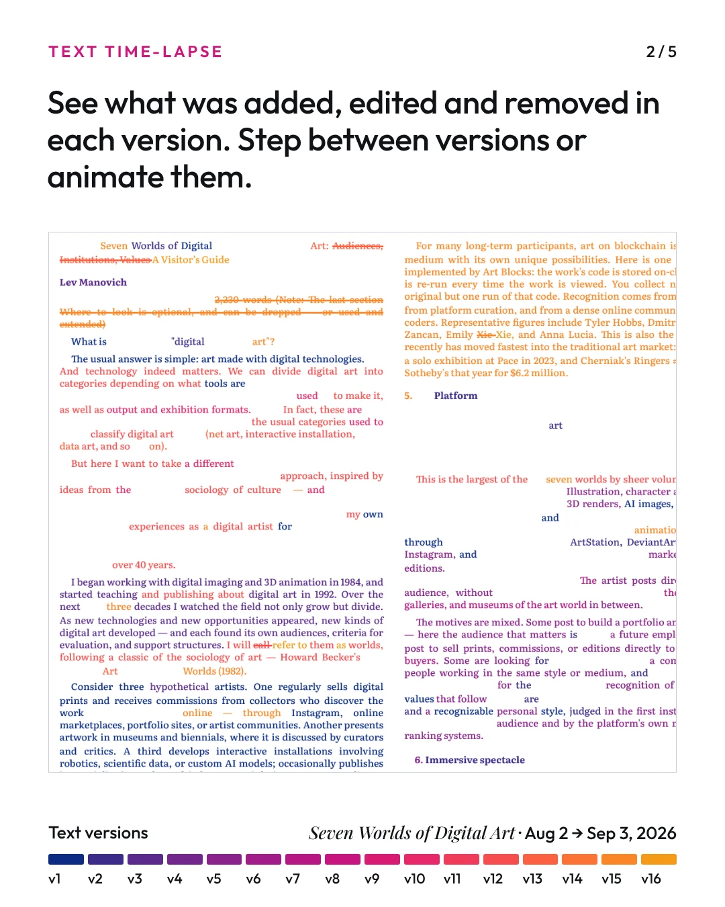
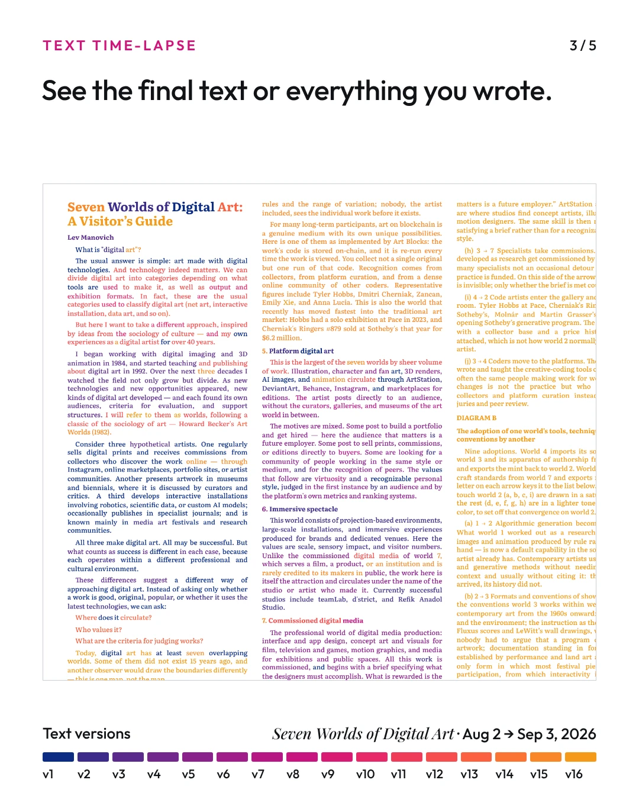

# Text Time-lapse

# Guide

Nov 4, 2026 · @Lev Manovich

**Everything runs in your browser. Your files are read on your own computer and are never uploaded anywhere.**

## What it does

Text Time-lapse shows how a text changed across its saved versions. Load versions of your text you were saving while working, and the tool creates a visualization of your writing process. It shows which version each word was written in, which words were later removed, and which were rewritten. You can see the result on one page, as one small page per version or as a 3D stack of pages, and you can animate it to watch the text being written and revised.

  
  
  

## Preparing your files

Put the versions of one text in a folder, then choose the folder, choose the files, or drag them onto the page. You need at least two versions.

**Formats:** plain text (.txt), Markdown (.md) and Word (.docx). Other files in the folder are skipped, as are hidden files and Word's temporary `~$` files. To use Apple Pages or Google Docs files, export them to .docx or .txt first.

**Order:** the versions are sorted by file name. For example, text\_01.txt is taken as the first version, text\_02.txt as the second, and so on. Numbers are sorted as numbers, so 2 comes before 10. Name your files so that sorting A–Z gives the right order.

| Works | Does not sort correctly |
| --- | --- |
| essay v1.docx, essay v2.docx … essay v10.docx | final.docx, final 2.docx, final REALLY.docx |
| draft 1.txt, draft 2.txt … draft 12.txt | draft one.txt, draft two.txt |
| 2024-07-28 chapter.md, 2024-08-08 chapter.md | 28-07-2024 chapter.md (day first) |

**Dates:** the date shown for each version is the file's last-modified date. If the files were copied or downloaded together, they may all show the same date; the order still follows the names.

**Paragraphs:** each line of text counts as a paragraph. A short first line without a period is treated as the title, and short lines without a period as headings.

## Controls

The page starts with a few main controls. More options appear when you choose a view or setting that uses them.

### Main controls

| Row | Controls | What they do |
| --- | --- | --- |
| Files | Choose a folder… / Choose files… | Load your versions. You can also drop files or a folder on the page. |
| Text view | Final text / All written text / Deleted / Edited | Choose which words the page shows: the final text; everything ever written, with cut words crossed out; only what was removed; or only the rewrites. Each button shows its word count. |
| Modes | Text / Blocks / Pages / 3D view | Show the words as text, as colored bars, as one small page per version, or as a 3D stack of pages. The Pages button shows the number of versions, for example 10 pages. Click a small page to open it. |
| Zoom | Slider / Large type / Whole page | Text and Blocks only. Whole page shows the entire text in columns, so you see the overall pattern of colors; the page opens this way (1.0×). Large type shows about 10 readable lines on screen, in one long column that you scroll down. The slider sets any size in between, or smaller. |
| Color | Palette / Soft hues / Bright hues / Grays | Choose the colors of the versions: a palette that blends from the oldest version to the newest, a calm color for each version, a bright and clearly different color for each version, or grays. With Palette, you can also pick a color set from the menu, set your own three colors, and move the middle color with Mid. |
| Page | Justified / Left aligned; A4 / 4:5 / Square / 9:16 / 16:9; Line spacing | Set the text alignment, the shape of the page and the space between lines. They apply to every view, including Pages, the 3D view and the player. |
| Coloring | Edits same color / Edits darker; Earlier in color / Earlier in gray | Edits darker shows rewritten words in a darker shade of their version's color, and new words a little lighter. Earlier in gray turns earlier versions gray while an animation runs, so the version being added stands out. |
| Animate | Revisions / Versions / Write | Choose an animation. It starts at once, with a one-line explanation and its own controls (see Animations below). In 3D view, this row also has Spacing and Transparency: the distance between pages and how see-through they are. |

**Above the page,** a line names the text and gives its numbers: versions, dates, words written, words in the final version and words removed. The **Example** button at the start of this line brings back the example the page opens with: 16 saved versions of *Seven Worlds of Digital Art* by Lev Manovich (August–September 2026). Below the line, one button per version shows its color and word count. Click one or more to show only their words. In 3D view, clicking a version builds the stack up to it.

### Animations

- **Revisions** shows each version's changes in turn: new words are written in, cut words are crossed out and disappear, and rewrites replace the old words. It opens the player, described below.
- **Versions** shows the chosen text view (for example Final text) one whole version at a time: v1, then v2, and so on. Its controls are Play / Stop and Time per version.
- **Write** shows all text ever written, word by word, version after version, with cut words crossed out. Its controls are Play / Pause, Close-up (a magnifier while paused) and Words/s.

### Player

Choosing **Revisions** opens the player. It starts playing at once, from an empty page; **Close player** takes you back. The Text view row is hidden in the player. The **Player** row holds the key controls: Play / Pause, ⏮ Start (back to the empty page), ◀ ▶ (previous or next version), a position slider, Time per version, and Zoom (when zoomed in, scroll inside the page to read a passage). Click a version button to play just that version; the space bar also plays and pauses. **More options…** opens the rest:

- **Timing:** Crossed out sets how long removed words stay visible, Pause how long the player stops after each version, and Big versions longer gives versions with more changes more time.
- **Changes:** All at once, Reading order or Scattered; Final text in gray (fixed layout) or Text grows (the real length of each version); Cuts disappear or Cuts stay.
- **Show as:** Text or Blocks, for the player's page only.
- **Blocks** (only with Blocks): Lightness, Saturation, Bar height and Word gap shape the colored bars.
